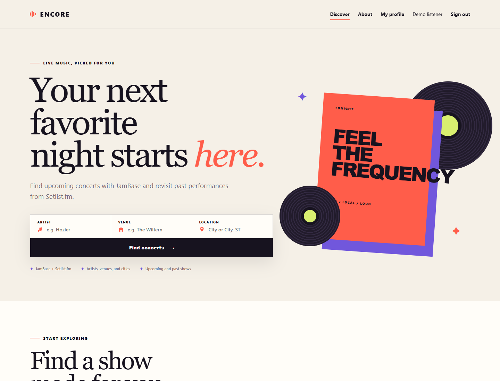
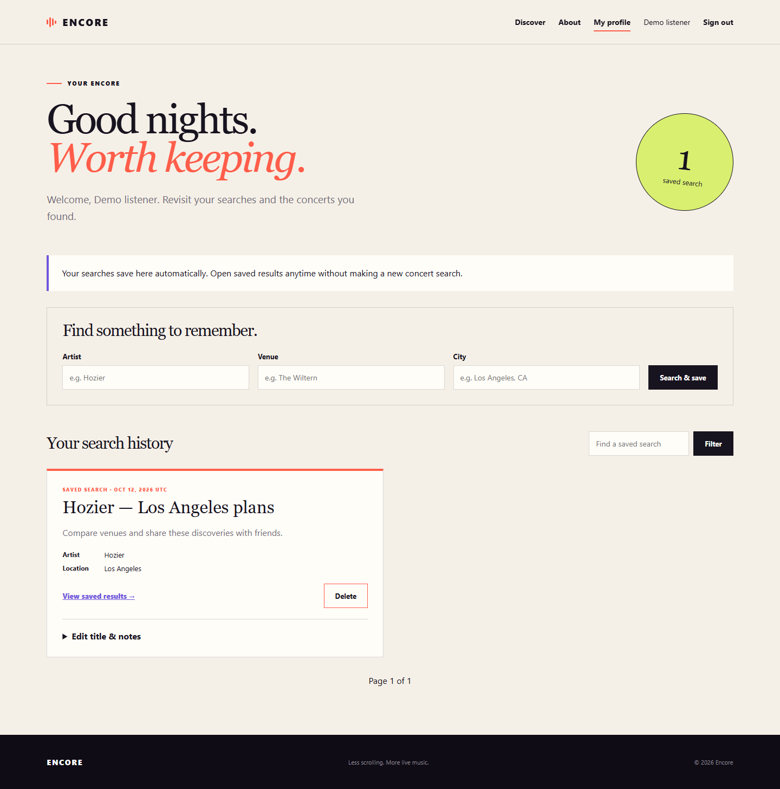
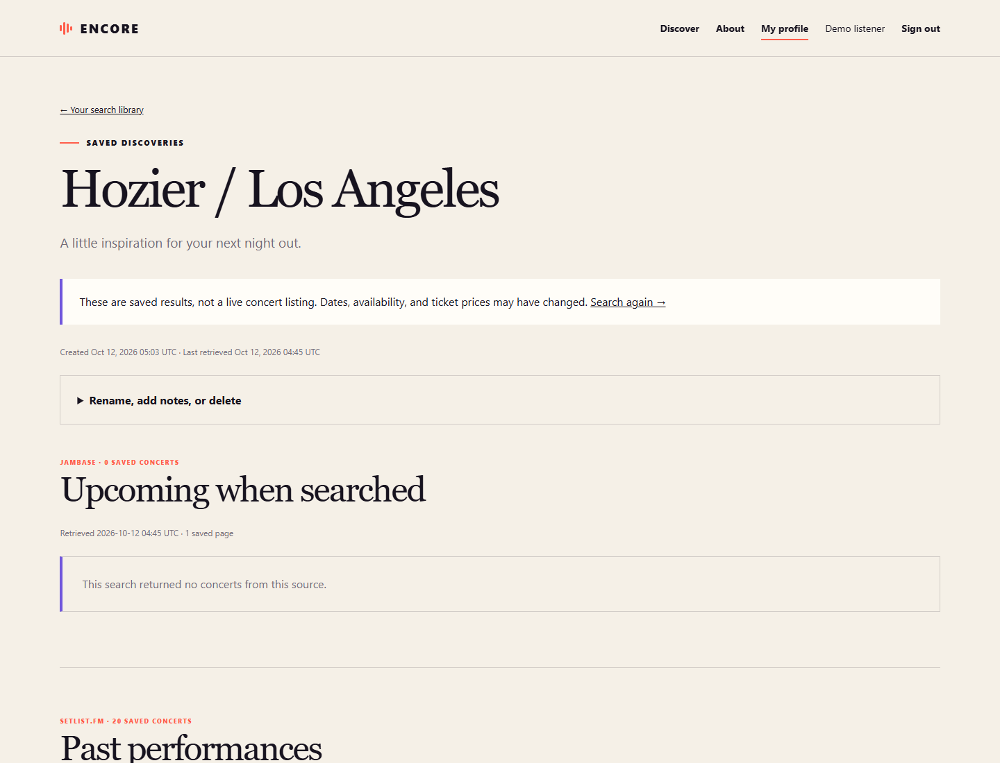
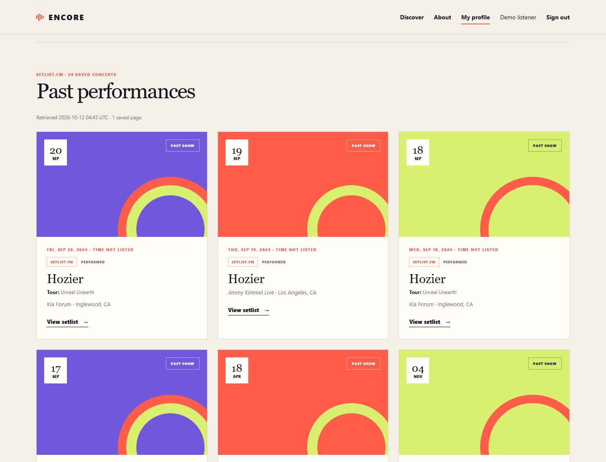
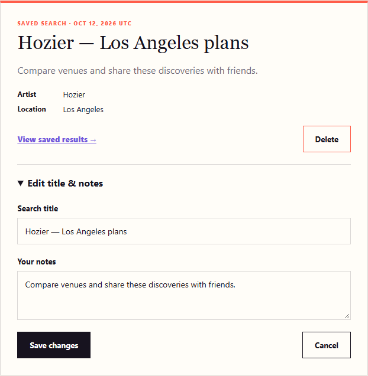
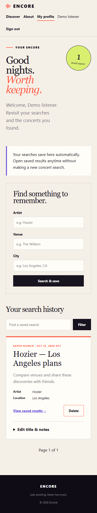

# Encore

**Student:** Hardik Katbamna

**Course:** IT 401

**Assignment:** A3 — Expanding the Web Intelligence Application with Information Persistence

**Branch:** `hkatbamna-it401-a3`

## Project Overview

Encore helps concertgoers discover upcoming shows through JamBase and revisit past performances through Setlist.fm. Search by artist, venue, and city, sign in with Google, and keep a private library of searches and the results you actually viewed. Rename a saved search, add personal notes, or delete it through the web interface.

A3 adds Flask-SQLAlchemy persistence on CI Keys **MariaDB 11.4.13**, using the MySQL-compatible PyMySQL driver. MariaDB is the database engine provided by this CI Keys account. Google OAuth/OpenID Connect handles sign-in; Encore stores no Google passwords or access tokens.

## Information Persistence

The database stores Google account identifiers, display names, verified emails, private saved searches, notes, search filters, retrieved concert snapshots, and shared API response pages. This data survives Flask restarts.

Signed-in searches are saved automatically when at least one provider returns successfully, including successful empty results. Each user has one history entry per normalized filter combination. Repeating the search updates that entry's last-searched time and viewed pages while preserving its title and notes. Guests benefit from the shared cache but do not receive personal history.

Shared JamBase pages are reused for six hours; Setlist.fm pages for 24 hours. Expired entries are refreshed only when requested. Saved personal snapshots remain available after cache expiration, without contacting either concert API. Refreshing another user's search never changes your saved snapshot. Searching again yourself can update your snapshot; a changed first page resets that source's previously saved pagination to avoid combining different retrievals. Only pages actually loaded are saved.

Temporary information includes API request objects, failed API responses, Google authorization state, and login-session cookies. Remote image files are not downloaded into the database; cards retain image URLs. Viewing saved cards may request those images, but never calls the concert search APIs.

## Database Schema

Every model includes `id` (integer primary key), `title`, `description`, `source`, `source_url`, `retrieved_at`, and `created_at`. Dates are stored in UTC. Source URLs on saved searches are internal discovery URLs; individual concert records retain provider attribution URLs.

| Table | Purpose | Additional fields and constraints |
| --- | --- | --- |
| `encore_users` | Google-authenticated accounts | Unique `google_sub`, nullable verified `email`. Title is the display name. Google subject identifies the account independently of email changes. |
| `encore_saved_searches` | Private saved search and result snapshot | `user_id` foreign key, `query_key`, JSON `filters`, JSON `snapshots`, `last_viewed_at`. Unique `(user_id, query_key)` prevents duplicate searches for an account. Description contains editable personal notes. |
| `encore_cached_results` | Shared normalized response for one source/query/page | Unique `cache_key`, JSON `filters` and `events`, `page`, `total`, `has_more`, indexed `expires_at`. Retrieval time and expiration decide whether another API call is needed. |

Relationships: one user owns many saved searches. Cache entries are independent of users. A saved search copies viewed cache pages, so deletion of private history does not remove shared results or affect another user.

Concert JSON retains external ID, title/name, artist, venue, location, date labels, ticket and attribution URLs, image URL, source, status, and lineup/tour details. Its enclosing snapshot supplies retrieval time. A page is the acquired dataset entity: preserving the complete normalized response retains exact saved cards and provider pagination. This deliberately avoids a separate mutable event catalog in A3. A4 can normalize events and add retrieval indexes.

## Application Architecture

Browser → Flask routes → validation → persistence service → SQLAlchemy → CI Keys MariaDB.

On a cache miss, the persistence service invokes JamBase or Setlist.fm, validates normalized records, stores the result page, and returns it to Jinja templates. Google login creates or resolves the database user. The profile routes obtain ownership from the signed session and query only that user's records.

The local database connection follows: Flask → `127.0.0.1:3307` → SSH tunnel → CI Keys `127.0.0.1:3306`. Workbench is optional and is not part of the application's runtime.

## Information Flow

1. A visitor submits artist, venue, or city filters.
2. Flask validates length and control characters, trims and collapses whitespace.
3. A SHA-256 key identifies the case-normalized filter combination, provider, page, and normalization version.
4. A fresh database cache entry supplies the results immediately. Otherwise, the provider is queried and its successful result persisted.
5. For signed-in users, the acquired or cached page is copied into their saved search.
6. Templates render results with source attribution and retrieval time.
7. `/profile` lists private history. Opening a saved result reads only stored snapshots.

## Current Features

- Homepage with artist, venue, city, upcoming and historical concert results.
- JamBase events and city-resolution API integration; Setlist.fm search API integration.
- No web scraping: A2 uses the official APIs instead of downloading third-party HTML.
- Google login, eight-hour signed sessions, and CSRF-protected Encore logout.
- MariaDB persistence through Flask-SQLAlchemy and PyMySQL.
- Shared cache for first pages and pagination; successful empty results are cached too.
- Private `/profile` library with title filtering and 12 entries per page.
- Create: search from Discover or the profile's **Search & save** form while signed in.
- Read: open **View saved results**, even after restarting Flask or cache expiration.
- Update: expand **Edit title & notes** on a profile card, edit, and save without opening results. Cancel discards unsaved edits. The results page also has editing controls.
- Delete: use **Delete** directly on a profile card, or delete from the results page, with confirmation; other users and shared cache remain unaffected.
- Accessible form labels, responsive layouts, clear empty states, and visible error messages.

## Project Structure

| Path | Purpose |
| --- | --- |
| `app.py` | App factory, database initialization command, safe database/input error responses |
| `config.py` | Environment configuration, MariaDB URL, session security, cache lifetimes, isolated test settings |
| `models/__init__.py` | SQLAlchemy instance, account/search/cache models, metadata fields |
| `routes/main.py` | Discovery and cached pagination routes |
| `routes/auth.py` | Google login callback and logout |
| `routes/profile.py` | Protected history, ownership checks, edit/delete, CSRF |
| `services/persistence.py` | Validation, normalization, caching, user resolution, private snapshot persistence |
| `services/search_service.py` | JamBase acquisition and normalization |
| `services/setlist_service.py` | Setlist.fm acquisition and normalization |
| `services/api_service.py` | HTTP API requests |
| `templates/`, `static/style.css` | Jinja pages, shared event cards, responsive styling |
| `tests/` | Isolated unit/integration tests; no real API calls or production data |
| `scripts/verify_database.py` | MariaDB transaction test and one real cached search verification |
| `scripts/build_a3_report.py` | Build screenshots and PDF using a disposable local demonstration database |
| `docs/screenshots/a3/`, `docs/Encore-A3.pdf` | A3 screenshots and submission report |

## Installation Instructions

Clone the repository and enter it:

```powershell
git clone https://github.com/hkatbamna1/hkatbamna-IT401project.git
cd hkatbamna-IT401project
git switch hkatbamna-it401-a3
python -m venv .venv
.\.venv\Scripts\python.exe -m pip install -r requirements.txt
```

Create `.env` using the variables below. Never commit credentials. Assign the database user to the database in CI Keys with appropriate table creation and CRUD permissions.

Start the SSH tunnel in a separate terminal, adjusting username, host, and private-key location for your account:

```powershell
ssh -N -T -o IdentitiesOnly=yes -o ExitOnForwardFailure=yes -L 127.0.0.1:3307:127.0.0.1:3306 -i "$env:USERPROFILE\.ssh\cikeys" -p 22 hardikka@csuci.dooo.host.reclaimhosting.com
```

Keep it running. Initialize the tables and start Flask from the project directory:

```powershell
.\.venv\Scripts\python.exe -m flask --app app init-db
.\.venv\Scripts\python.exe app.py
```

Open `http://127.0.0.1:5000`, sign in, and search. Use **My profile** to revisit results. Restart Flask after editing `.env`.

`init-db` creates missing Encore tables only. It does not drop data or migrate existing table definitions. Schema changes after this initial A3 schema require a reviewed migration; `create_all()` is not a migration system.

### Google OAuth configuration

Use a Google Auth Platform Web application client with `openid email profile` scopes. Register `http://127.0.0.1:5000/auth/google/callback` and `http://localhost:5000/auth/google/callback`. While testing, add the intended Google accounts as test users. Use one hostname consistently through a login attempt. Authlib validates OAuth state and Google token signature, issuer, audience, expiry, and nonce.

Production requires a registered HTTPS callback and `FLASK_ENV=production` for secure cookies. Configure trusted proxy handling as appropriate to the deployment. The eight-hour cookie contains limited identity details, not Google tokens; Flask signs but does not encrypt it.

## Environment Variables

```dotenv
FLASK_ENV=development
SECRET_KEY=replace_with_a_random_secret_at_least_32_characters
GOOGLE_CLIENT_ID=your-client-id.apps.googleusercontent.com
GOOGLE_CLIENT_SECRET=your-google-client-secret
JAMBASE_API_KEY=your-jambase-key
SETLISTFM_API_KEY=your-setlistfm-key
DB_HOST=127.0.0.1
DB_PORT=3307
DB_NAME=hardikka_IT401_db
DB_USER=hardikka_IT401_user
DB_PASSWORD=your-database-password
```

`DB_PASSWORD` is required. Host, port, database name, and user default to the working local CI Keys tunnel settings above. Credentials are passed using SQLAlchemy's URL builder so passwords containing punctuation need no manual URL encoding. `SECRET_KEY`, Google client ID, and Google client secret are required for login. Each concert API key is required only for uncached requests to that provider. `AI_SERVICE_API_KEY` remains optional and unused.

Generate a session secret with `python -c "import secrets; print(secrets.token_hex(32))"`. Copy it into `.env`; keep existing API keys. `.env` is ignored by Git.

## Data Validation and Error Handling

| Condition | Behavior |
| --- | --- |
| Invalid search input | Reject fields longer than 160 characters or containing control characters with HTTP 400, before acquisition. Empty homepage searches make no API calls; empty pagination requests are rejected. |
| Invalid page | Reject non-integers or values outside 1–1000. |
| Invalid edits | Require a nonblank title of at most 200 characters; notes at most 4,000 characters. Jinja escapes stored text. |
| Missing external values | Supply title/venue defaults; preserve date/lineup normalization from A2; missing event IDs get deterministic content hashes. |
| Unsafe URLs | Retain only HTTP(S) URLs with hosts; clear malformed or oversized image/ticket/source URLs. |
| Duplicates | Deduplicate event IDs within a response; deduplicate display across saved pages; enforce unique cache keys, Google subject, and user/query pairs. Retry competing history inserts once. |
| Missing API key | Reuse fresh cache if available; otherwise show a source-specific setup error. |
| Provider failures | Show an error for that source, retain any successful other source, and never cache the error as an empty result. |
| Database errors or closed tunnel | Roll back the transaction; return a generic 503. Cache-read failure stops acquisition to avoid spending API calls without storage. No silent SQLite fallback. |
| Unauthorized record ID | Read, update, and delete queries require the current user's ID; another user's records return 404. |
| Missing/invalid CSRF token | Reject edits, deletion, and logout. Profile responses use private/no-store browser caching. |

## Screenshots

The A3 images use a clearly named demonstration account in an isolated local database, populated from real acquired result pages. They exercise the same production routes/templates without adding a fake Google login route or committing demonstration accounts to CI Keys. Capture date and source are included in the PDF. The remote database is separately verified using the verification script.








The PDF report is [Encore A3](docs/Encore-A3.pdf). Existing A2 screenshots remain in `docs/screenshots/`.

## Design Decisions

- Keep private history separate from shared cache so equivalent searches can reuse external results across accounts while notes and ownership remain private.
- Preserve independent snapshots so cache refreshes do not silently replace another user's saved results.
- Use one entry per user/query instead of logging every refresh. This prevents duplicate clutter; `created_at` and `last_viewed_at` distinguish first save from latest search.
- Preserve provider source links and retrieval timestamps. Saved results are explicitly labeled historical snapshots, not guaranteed current availability.
- Use the hosted MariaDB service rather than local-only application storage. SQLite is limited to isolated tests and documentation previews.
- Include all assignment metadata columns on every model and use JSON for normalized result pages to preserve the A2 card structure. Extra IDs, hashes, timestamps, and ownership fields support deduplication, cache expiration, and access control.

## Testing and Verification

```powershell
.\.venv\Scripts\python.exe -m pytest -q -p no:cacheprovider
```

Tests cover A2 normalization and routes, signed Google-token validation, cache reuse and expiration, persistence across app instances, empty results, private snapshot isolation, CRUD, ownership, CSRF, validation, guest behavior, and database failures. All automated tests use isolated SQLite databases and mocked providers, never the hosted account.

With the SSH tunnel and API keys ready, run `python scripts/verify_database.py` to exercise MariaDB ORM create/read/update/delete inside a rolled-back transaction, fetch one real Hozier/Los Angeles query, and prove the repeat query makes no API calls. The acquired result pages remain cached; no verification user is committed.

To rebuild the PDF/screenshots, install `pip install -r requirements-docs.txt`, then run `python scripts/build_a3_report.py`. This uses the installed Microsoft Edge browser and reads real cached pages; it generates demonstration data only in an isolated SQLite database and writes documentation artifacts.

## Known Limitations

- Local development needs the SSH tunnel open. Deployment needs a reliable server-side database connection rather than a terminal on a developer's laptop.
- Cache expiration is six hours for JamBase and 24 for Setlist.fm; values are application settings, not a claim about provider licensing. API usage and retention must follow the provider agreements applicable to this account.
- Simultaneous cold-cache requests can still make duplicate API calls before the unique cache record is committed; no distributed request lock is implemented.
- Cache refresh is request-driven, with no background cleanup. Saved results persist until the owner deletes or replaces them by searching again. There is no account deletion/export interface yet.
- History is a latest snapshot per normalized query, not a complete audit log of every search. Only viewed pages are saved; no automatic bulk acquisition is performed.
- Editing history changes title/notes, not provider facts. Dates, prices, ticket availability, external images, and links can change.
- Workbench 26.7.0 can fail on MariaDB during initialization; phpMyAdmin and the Python connection work independently of Workbench.
- No production deployment, full-text event index, favorites, or recommendations yet. A schema migration framework is not included in this initial A3 implementation.

## Future Work

A4 can normalize concert entities, add database-backed full-text retrieval and ranking, filter by date and venue, and build recommendations from saved searches. Other useful additions include favorites, account export/deletion, retention controls, and automated deployment/tunnel management.
