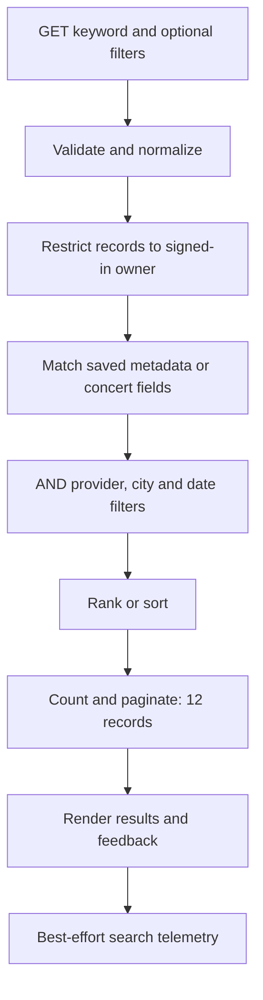
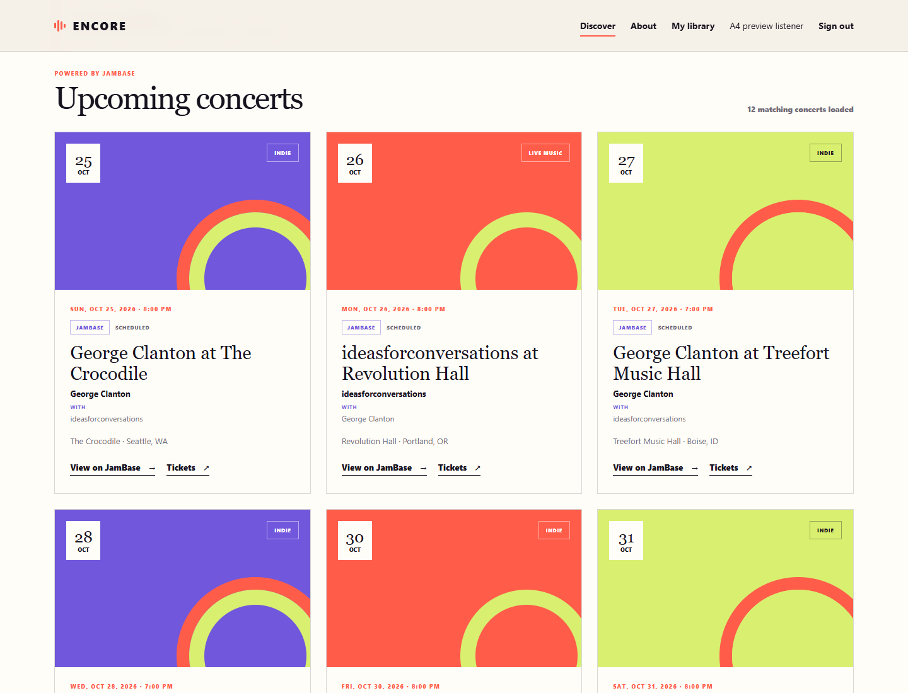
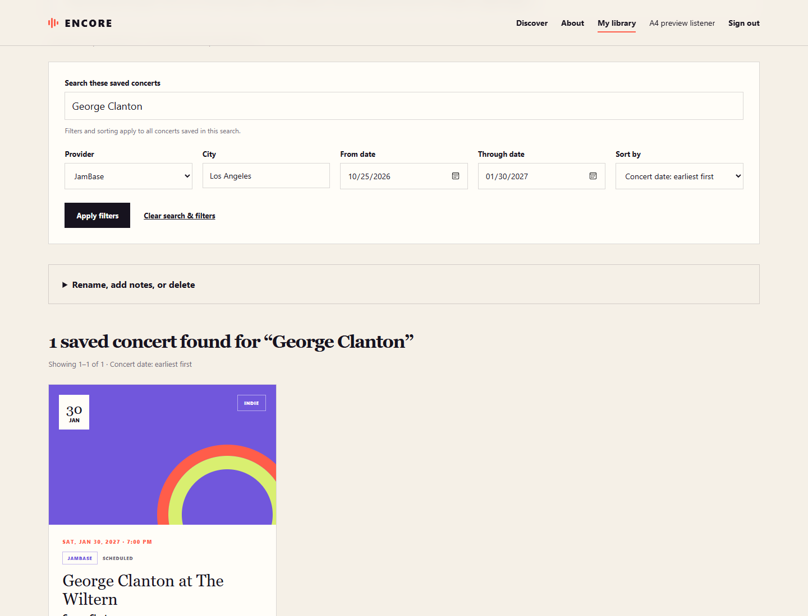
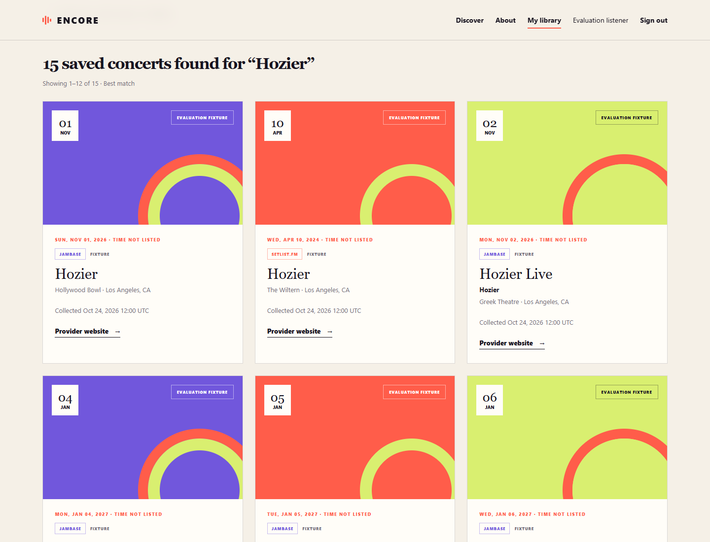
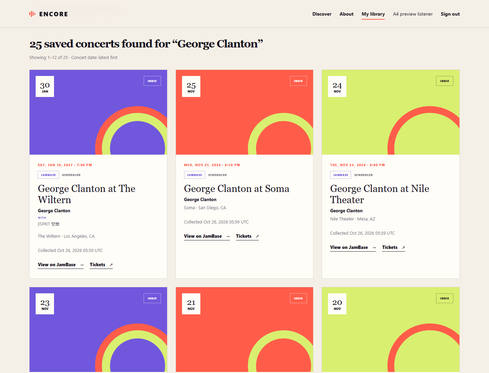
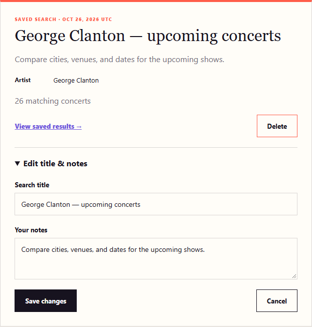

# Encore

**Application:** Encore

**Student:** Hardik Katbamna

**Course and assignment:** IT 401 — A4: Expanding the Web Intelligence Application with Search

**Branch:** `hkatbamna-it401-a4`

## Project Overview

Encore helps concertgoers discover upcoming concerts through JamBase, revisit performances through Setlist.fm, and keep a private library of concert searches. Its intended users are listeners comparing artists, venues, cities, and dates before planning a night out or revisiting a previous show.

A4 makes those stored discoveries searchable. Users can search their own saved titles, notes, and concert facts, combine filters, rank or sort results, and move between result pages. This avoids repeating an external concert search just to find information already saved.

The application continues to use Flask, Flask-SQLAlchemy, SQLAlchemy models, PyMySQL, and the existing CI Keys **MariaDB 11.4.13** service. MariaDB is the MySQL-compatible database supplied by this account. SQLite is used only for isolated tests and documentation previews; the application does not silently fall back to it when MariaDB is unavailable.

The main interface has two areas:

- **Discover:** Search JamBase and Setlist.fm by artist, venue, and city. Provider, date, and sorting controls refine the results loaded so far. Load more to expand that result set; the page does not claim to rank every unrequested provider page.
- **My library:** Search only your private saved searches and their concerts. Open **View saved results** to search, filter, sort, and paginate all concerts stored in that particular snapshot. Rename searches, edit notes, or delete saved records.

The former separate collection interface is merged into My library. Bookmarked `/search?...` URLs redirect to `/profile?...`; library access requires Google sign-in.

## Search and Retrieval Features

| Feature | Current behavior |
| --- | --- |
| Keyword search | Dedicated HTML GET forms in My library and saved results; `q` remains in the URL and input after submission. |
| Fields searched | Saved title and notes, plus concert title, artist, venue, and tour. |
| Filters | Provider, city/location text, and inclusive from/through concert dates. Filters combine with the keyword using AND. |
| Sorting | Best match, concert date earliest/latest, alphabetical title; My library also offers recently searched and oldest searches first. |
| Ranking | Weighted exact/partial title or artist matches, venue/tour signals, and saved-search metadata boosts. |
| Pagination | 12 saved searches or 12 concerts per page, with Previous/Next, page labels, and preserved query/filter/sort parameters. |
| Feedback | Initial browsing guidance, matching counts, no-results suggestions, safe validation and database-error responses. |
| Telemetry | Persisted query, timestamp, matching-result count, filters, sort, scope, and account ID for completed database searches. |

## Search Workflow

The database retrieval sequence is **Retrieve → Filter → Rank → Paginate → Display**. SQLAlchemy builds the statement; the database applies matching, filtering, ordering, counting, and LIMIT/OFFSET before templates receive the current page.



Example database searches:

```text
/profile?q=George+Clanton&source=jambase&sort=relevance
/profile/searches/1?q=George+Clanton&date_from=2026-10-25&sort=date_asc
```

The numeric saved-search ID depends on the account. Read, update, and delete requests check ownership; another user's ID returns 404.

Acquisition follows a separate path: **Discover → shared cache or provider → normalized acquired page → private snapshot and searchable saved-concert index**. The acquisition cache uses artist, venue, city, provider, and page; display date/sort refinements do not change the acquired underlying page. Signed-in users save loaded provider pages, including concerts hidden by a temporary display filter, and can refine those snapshots independently later.

## Searchable Information

| Model or field | Retrieval role and reason |
| --- | --- |
| `SavedSearch.title` | Searchable user-assigned label, such as a weekend plan; affects library ranking. |
| `SavedSearch.description` | Searchable private notes; helps recall a search using personal context. |
| `SavedConcert.title`, `artist` | Searchable identifying facts; exact and partial matches affect relevance. |
| `SavedConcert.venue`, `tour` | Searchable ways to recall a performance; contribute smaller ranking weights. |
| `source`, `location`, `event_date` | Provider, city and date filters; dates also support ordering. |
| `source_url`, image and ticket URLs, retrieval time | Attribution, display, freshness, and links; excluded from keyword matching. |
| Owner IDs | Access control only; never a user-selectable filter. |
| Shared `Concert` records | Acquisition catalog; My library does not search other users' or shared-only records. |

`SavedSearch.snapshots` remains the authoritative saved JSON. `SavedConcert` is a searchable projection of its exact contents, with a foreign key to the saved search. A shared catalog refresh cannot replace another listener's saved facts. Deleting a saved search removes its private projection while leaving the shared cache/catalog intact.

## Retrieval Strategy

Concert queries and searchable concert fields use **NFC Unicode normalization, whitespace normalization, and case folding**. The original input is retained for display and telemetry. Matching treats the normalized input as a contiguous keyword or phrase; it does not yet split a phrase into independent search tokens.

This applies Manning's normalization concept: equivalent case and character representations map to a consistent matching form. Splitting whitespace helps normalize spacing, but the application does not claim to implement a full tokenization, stemming, or semantic-search pipeline. Saved-search title/notes matching uses trimmed input and database `LOWER` for case-insensitive metadata matching.

SQLAlchemy `contains(..., autoescape=True)` builds parameterized LIKE expressions. `%`, `_`, and the escape character are matched literally, and raw user input is never interpolated into manually assembled SQL. Concert fields are combined with OR; provider, city and inclusive date bounds are combined with AND. Filters must match the same saved concert, rather than different concerts merely belonging to the same saved search.

In My library, a saved title/notes match or matching concert can retrieve its parent search. A metadata-only match can find a saved search with no concerts; selecting a concert filter requires an actual matching concert. Opening a metadata match clears that metadata keyword from the concert-only view while preserving applicable filters.

### Relevance and ordering

| Concert match | Weight |
| --- | --- |
| Exact artist OR concert title | +5 |
| Otherwise, partial artist OR title | +3 |
| Venue substring | +2 |
| Tour substring | +1 |

The exact and partial tiers are exclusive; venue/tour weights are additive. These signals favor performer identity while supporting searches remembered by venue or tour. In the controlled Hozier example, exact performer matches score 5 and appear before a tribute's partial-title score of 3.

Library best-match ranking takes the highest matching child-concert score and adds 8 for an exact saved title, or 3 for a partial title/notes match. This gives useful weight to a listener's own organizational labels. **Recently searched** is the library's default; users choose **Best match** for relevance ordering.

Relevance ties use normalized title and ID; every other ordering includes an ID tie-breaker. Unknown concert dates sort last in both date directions. Library concert-date sorting uses the earliest/latest matching child date. Twelve results suit the existing card layout and limit database transfer and page rendering.

## Search Telemetry

`SearchEvent` records original and normalized query, UTC timestamp, total matching-result count, JSON filters, sort, and current account ID. The filters include an internal scope: `library` or `saved:<id>`.

- In My library, the result count means matching **saved searches**; inside a saved search, it means matching **concerts**. Counts cover all result pages, not only the 12 displayed rows.
- Completed keyword and provider/city/date-filter searches are recorded, including successful zero-result searches.
- Initial/empty browsing, sort-only browsing, invalid input, retrieval failures, and requests containing a `page` parameter are not recorded. Pagination therefore does not create a second event; manually reopening a URL without `page` can.
- A telemetry write failure rolls back independently and leaves the retrieved results visible.
- **Search activity** is authenticated, owner-scoped, and private/no-store. Replay links return to the relevant private search. SearchEvent does not collect Google tokens, email addresses, IP addresses, session identifiers, clicks, or dwell time.

Frequent queries and filter combinations can guide future acquisition or recommendations. Zero-result terms can reveal missing aliases, spelling support, or coverage. Click-based ranking evaluation would require additional telemetry that is not currently collected.

## Database Schema

All tables use integer `id` primary keys. The five content/account models share `title`, `description`, `source`, `source_url`, `retrieved_at`, and `created_at`. `SearchEvent` has its own query-focused attributes. Timestamps are stored in UTC; concert dates retain the provider's calendar date.

| Table | Purpose | Important attributes and constraints | Relationships |
| --- | --- | --- | --- |
| `encore_users` | Google-authenticated account | Unique `google_sub`, display title, nullable verified email | One user has many saved searches and search events. |
| `encore_saved_searches` | Private labels, notes, acquisition filters and saved pages | `user_id`, unique `(user_id, query_key)`, JSON `filters`/`snapshots`, `last_viewed_at` | Belongs to user; owns saved concerts. |
| `encore_cached_results` | Shared acquired provider page | Unique `cache_key`, JSON events/filters, page, total, has_more, indexed expiration | Independent of private ownership. |
| `encore_concerts` | Shared normalized acquisition catalog | Unique `(source, external_id)`, typed date, artist, venue, location, tour, normalized search columns, card JSON | Independent of personal snapshots. |
| `encore_saved_concerts` | Searchable exact private snapshot projection | `saved_search_id`, unique `(saved_search_id, source, external_id)`, typed date and normalized concert fields | Belongs to saved search; deleted with it. |
| `encore_search_events` | Completed database-search telemetry | Query, normalized query, timestamp, result_count, JSON filters/scope, sort, nullable `user_id` | Account foreign key; no clicked-concert relationship. |

Event-date and normalized-location indexes support retrieval structure, and unique keys prevent duplicate identities. Substring matching with a leading wildcard may still scan records; these are not full-text indexes.

Alembic migrations adopt or create the A3 baseline, add the shared catalog/telemetry tables, then add the private saved-concert projection. `backfill-catalog` and `backfill-saved-concerts` rebuild derived indexes from stored pages without concert API calls or changes to saved notes.

## Current Features

- Homepage and Discover search for upcoming and historical concerts.
- Official JamBase and Setlist.fm API acquisition, provider attribution and HTTP(S) URL validation.
- No HTML scraping: the project acquires information through official APIs.
- Google OAuth/OpenID Connect, eight-hour signed sessions, and CSRF protection for mutations/logout.
- Persistent MariaDB data, shared six-hour JamBase / 24-hour Setlist.fm caches, and private saved snapshots.
- CRUD: create a saved search through signed-in discovery; read snapshots; edit title/notes; delete with confirmation.
- Database-backed multi-field keyword search, Boolean filters, relevance ranking, multiple sorts and pagination.
- Completed-search telemetry, private activity history, and replay links.
- Input validation, helpful empty/error states, rollback handling, ownership protection and responsive cards/forms.

## Project Structure

```text
app.py                         App factory, error handlers and backfill CLI commands
config.py                      Environment/database/session/cache/test configuration
models/__init__.py             Account, saved search, cache, concert and telemetry models
routes/
  main.py                      Provider discovery and load-more endpoints
  profile.py                   Private library, saved-result retrieval, CRUD and activity
  search.py                    Legacy /search redirect and stored-concert detail compatibility
  auth.py                      Google authentication and logout
services/
  retrieval.py                 Validation, dynamic SQL, ranking, pagination and telemetry
  result_controls.py           Refinement of loaded discovery pages
  catalog.py                   Normalized shared/private projections and backfills
  persistence.py               Acquisition cache and authoritative saved snapshots
  search_service.py            JamBase acquisition/normalization
  setlist_service.py           Setlist.fm acquisition/normalization
  api_service.py               Provider HTTP requests
  ai_service.py                Placeholder; unused
migrations/                    Reviewed Alembic baseline and additive A4 revisions
templates/
  profile.html                 Library search form, saved-search results and CRUD
  saved_search.html            Search/filter/sort/paginate a private concert snapshot
  _search_controls.html        Shared provider/city/date/sort controls
  _results_pagination.html     Previous/Next links preserving search parameters
  search_activity.html         Private telemetry display and replay
  index.html, _event_cards.html Discovery and shared concert cards
static/style.css               Responsive interface styles
tests/                         Isolated service, route, privacy, persistence and migration checks
scripts/
  a4_evaluation.py             Frozen corpus, relevance judgments and private-flow evaluation
  acquire_a4_examples.py       Acquire real George Clanton pages for evidence
  verify_a4_database.py        Isolated tests and real MariaDB/private-route verification
  build_a4_report.py           Current browser screenshots, evaluation JSON and PDF
docs/                          A4 evidence/report; earlier assignment artifacts retained
```

## Installation Instructions

Clone the repository, switch to A4, and install dependencies:

```powershell
git clone https://github.com/hkatbamna1/hkatbamna-IT401project.git
cd hkatbamna-IT401project
git switch hkatbamna-it401-a4
python -m venv .venv
.\.venv\Scripts\python.exe -m pip install -r requirements.txt
Copy-Item .env.example .env
```

Fill `.env` with your own existing API, Google and database configuration. Assign the database user to the CI Keys database with the required table creation and CRUD permissions. Keep credentials out of Git.

Start the SSH tunnel in a separate terminal, substituting the account/host and private-key path:

```powershell
ssh -N -T -o IdentitiesOnly=yes -o ExitOnForwardFailure=yes -L 127.0.0.1:3307:127.0.0.1:3306 -i "$env:USERPROFILE\.ssh\cikeys" -p 22 your_cikeys_user@your_cikeys_host
```

Keep the tunnel running, apply migrations, and index any existing acquired/saved pages:

```powershell
.\.venv\Scripts\python.exe -m flask --app app db upgrade
.\.venv\Scripts\python.exe -m flask --app app backfill-catalog
.\.venv\Scripts\python.exe -m flask --app app backfill-saved-concerts
.\.venv\Scripts\python.exe app.py
```

Open `http://127.0.0.1:5000`, sign in, and run a discovery. Use **My library** to search saved information. Fresh installations may have nothing to backfill; later acquisitions populate the indexes automatically. Restart Flask after changing `.env`.

Use `db upgrade` for tracked schema changes. The legacy `init-db` command creates missing tables but is not a migration system. Upgrades preserve existing A3 records; restoring a database backup is the appropriate recovery mechanism for removing adopted baseline data.

### Google authentication

Configure a Google Web application client with `openid email profile` scopes. Register `http://127.0.0.1:5000/auth/google/callback` and `http://localhost:5000/auth/google/callback`; add intended Google test accounts while the consent application is in testing. Use one hostname throughout a login attempt.

Authlib validates OAuth state and the Google token's signature, issuer, audience, expiry and nonce. Encore stores limited identity data, not Google passwords or tokens. Production requires HTTPS, registered callbacks, a strong session secret and `FLASK_ENV=production` for secure cookies.

## Environment Variables

```dotenv
FLASK_ENV=development
SECRET_KEY=replace_with_a_random_secret_at_least_32_characters
GOOGLE_CLIENT_ID=your-client-id.apps.googleusercontent.com
GOOGLE_CLIENT_SECRET=your-google-client-secret
JAMBASE_API_KEY=your-jambase-key
SETLISTFM_API_KEY=your-setlistfm-key
DB_HOST=127.0.0.1
DB_PORT=3307
DB_NAME=your_database_name
DB_USER=your_database_user
DB_PASSWORD=your_database_password
```

Database credentials configure the MariaDB connection through SQLAlchemy's URL builder, including passwords containing punctuation. API keys are needed for uncached provider requests; stored private retrieval does not need them. Google credentials and a strong `SECRET_KEY` enable login. `AI_SERVICE_API_KEY` remains optional and unused. No actual credentials appear in the documentation.

## Error Handling

| Condition | Behavior |
| --- | --- |
| Initial/empty/whitespace library query | Browse saved records, show initial keyword/filter guidance, and skip telemetry. A filter-only search remains valid. |
| Long query/control characters | Reject fields over 160 characters or containing control characters with HTTP 400. |
| Invalid filter/sort/date | HTTP 400 with a helpful message; reject malformed dates and reversed date bounds. |
| Invalid page | Reject non-integers, nonpositive and nonexistent result pages. Database pages have a 1,000,000 input cap; provider pages have a 1,000 cap. |
| No matching records | Display zero matches and suggest a broader term or removal of filters; record the completed zero-result search. |
| Missing provider fields | Existing title/venue defaults, safe URLs and nullable dates keep cards renderable. Unknown dates sort last. |
| Database error/closed tunnel | Roll back and return generic HTTP 503: Search is temporarily unavailable. Do not expose SQL details. |
| Telemetry failure | Roll back its transaction; keep the already retrieved results visible. |
| Provider failure | Show a source-specific error and retain a successful other source; never cache the failure as an empty success. |
| Unauthorized ID or invalid CSRF | Ownership-scoped operations return 404 for another user's record; invalid mutation/logout tokens are rejected. |

## Search Evaluation

The current evaluation uses **18 synthetic, frozen concert fixtures in one private saved search**, a second empty search for notes matching, and another owner with an excluded private concert. These are controlled relevance judgments, not real concert listings. No fixture or documentation account is added to MariaDB.

`scripts/a4_evaluation.py` calls the production `retrieve_saved` and `retrieve_library` services. It also checks the rendered concert IDs and ranking order on every saved-result HTTP page. Six additional library checks cover concert fields, saved notes, metadata-only matches, another owner's exclusion and zero results.

| Query and filters | Expected relevant fixtures | Actual returned results | Precision / recall | Ranking and errors |
| --- | --- | --- | --- | --- |
| Hozier | h01–h14: 14 performances by Hozier | All 14, plus tribute | 14/15 = 93.3% / 100% | Useful exact matches occupy the top three; tribute is a false positive. |
| The Wiltern | h03, radiohead, muse | All three | 100% / 100% | Useful venue match first; no misses. |
| Hozier; Setlist.fm; Los Angeles | h03 | h03 | 100% / 100% | Combined filters isolate the useful result. |
| A Moon Shaped Pool | radiohead | radiohead | 100% / 100% | Tour matching finds the intended concert first. |
| RHCP | rhcp: Red Hot Chili Peppers | None | Undefined / 0% | Relevant record missed; no abbreviation expansion. |
| zzzx-no-concert | None | None | Undefined / undefined | Correct no-results state. |

**Precision** describes how many returned records were useful; **recall** describes how many expected relevant records were retrieved. Undefined values are not reported as perfect scores. Metrics cover all pages, not just the first 12 records. Full ranked IDs, expected records, false positives, missed records and top-three observations are in [the evaluation JSON](docs/a4-evaluation.json).

An artist alias dictionary could find RHCP and improve recall. Distinguishing performer identity from title mentions could reduce tribute false positives and improve precision. This small corpus does not establish recall across unacquired provider catalogs.

The real George Clanton example provides an additional coverage observation: JamBase's artist query acquired 26 records, while a concert-field keyword search finds 25. The remaining Portland record names ideasforconversations as its primary artist and lists George Clanton only in the supporting lineup. Searching the saved title still finds the complete saved search; concert-only matching does not index that supporting lineup. This is a documented missed relevant record and motivates complete lineup indexing.

### Testing and database verification

```powershell
.\.venv\Scripts\python.exe -B -m pytest -q -p no:cacheprovider
.\.venv\Scripts\python.exe scripts/verify_a4_database.py
```

The current suite has **88 passing tests**. Coverage includes normalization, literal input, ranking, filters, pagination, ownership, independent snapshots, telemetry failures, CRUD, authentication, migrations and the documented private-flow evaluation. Automated tests use isolated SQLite and mocked concert providers.

The verification script additionally checks current private-library and saved-result retrieval against configured MariaDB, all sorts with/without keywords, literal input, ownership and `/search` redirection. Concert API calls are blocked during the database-only HTTP checks. A telemetry insert is tested and rolled back; no verification account or fixture is committed. Evidence: [test output](docs/a4-tests.txt) and [MariaDB verification](docs/a4-database-verification.json).

## Screenshots

Most A4 screenshots use **real George Clanton JamBase results acquired October 25, 2026: 26 upcoming concerts over three pages**. The booking agency's [tour listing](https://groundcontroltouring.com/artists/george-clanton) corroborates the tour; individual cards retain provider links and timestamps. The [acquisition evidence](docs/george-clanton-acquisition.json) records exactly which pages were loaded.

Screenshots run the actual application routes in an isolated SQLite preview with a labeled demo account. Personal titles/notes are demonstrations. Real acquired concert facts are copied from the provider evidence; no fake login route, demonstration account or synthetic concert is written to the hosted database. Browser captures cannot call concert APIs. Optional unavailable remote images use Encore's normal fallback.

The ranking screenshot is separately labeled **synthetic evaluation data**. The [screenshot manifest](docs/a4-screenshot-manifest.json) records each image's route, caption and dataset.












The submission report is [Encore A4](docs/Encore-A4.pdf). Earlier A2/A3 artifacts remain in `docs/`.

To refresh the evidence and rebuild screenshots/PDF:

```powershell
.\.venv\Scripts\python.exe -m pip install -r requirements-docs.txt
.\.venv\Scripts\python.exe scripts/acquire_a4_examples.py
.\.venv\Scripts\python.exe scripts/verify_a4_database.py
.\.venv\Scripts\python.exe scripts/build_a4_report.py
```

This uses installed Microsoft Edge in headless mode. Acquisition may refresh the normal shared API cache/catalog; private verification writes roll back. Screenshot/evaluation accounts exist only in process-local SQLite. Rebuilding after tour dates have passed requires acquiring a suitable current example and updating the date-specific narrative rather than inventing listings.

## Design Decisions

- Keep Discover for acquisition and My library for private database retrieval, avoiding a third overlapping search destination.
- Search identifying concert fields and user labels/notes; use provider, location and date as narrowing controls; keep URLs and images as metadata.
- Index exact private snapshots separately from the mutable shared catalog so searching cannot expose another listener's records or silently replace saved facts.
- Use explainable weights and stable ordering before considering full-text or semantic search.
- Paginate at 12 records so the database limits transfer and the interface stays manageable.
- Keep saved-search history deduplicated per acquisition query while recording individual completed database searches separately for later intelligence.
- Distinguish real provider screenshots from controlled evaluation fixtures so evidence remains reproducible and honest.

## Known Limitations

- Substring phrases do not understand synonyms, abbreviations, spelling variants, singular/plural equivalence or arbitrary token order.
- Metadata matching uses database `LOWER`; locale-specific Unicode casing can differ from the concert index's case folding.
- Only acquired and personally saved pages are searchable in My library. Absence is not evidence that a concert does not exist.
- Discover filters/sorts apply to loaded pages; a date filter can hide the first page while relevant concerts exist on later pages. Load-more remains available.
- Display filters/sorting are independent of the acquired snapshot; the saved search retains loaded provider pages, not a permanently filtered subset.
- Provider duplicates remain separately attributed; truncated supporting-artist summaries are not a complete searchable lineup.
- Ranking is rule-based, not personalized. Leading-wildcard LIKE can scan rows at scale despite supporting indexes.
- Local development depends on the SSH tunnel; there is no production deployment, distributed cold-cache lock or automatic cache cleanup.
- Saved facts, ticket availability, remote images and links can become stale. Cache lifetimes are application settings, not statements of provider retention rights.
- There is no account deletion/export interface, favorites feature or click telemetry yet.

## Future Work

For A5 and later: artist aliases and query suggestions, token-aware/full-text retrieval, semantic embeddings, personalized relevance and recommendations, richer search evaluation and optional click-rank telemetry. Other improvements include cross-provider entity resolution, complete lineup indexing, favorites, account export/deletion and automated deployment/database connectivity.
